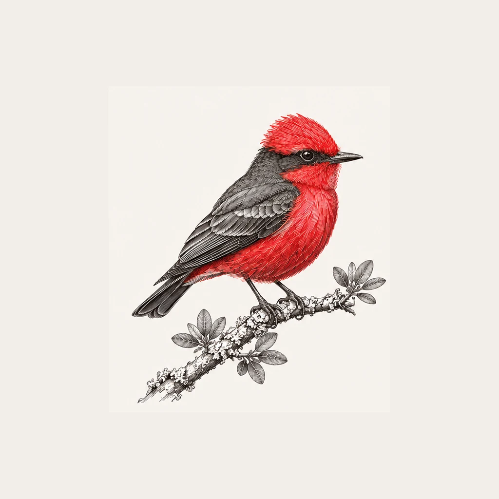

# ATLAS / STUDIO — Antique Illustration Studio V1.0

A private, self-hosted illustrated specimen studio, based on **Birds 1.0**, **Dogs 1.0**, **Fish 1.0**, and **Botanicals 1.0**. Build a numbered collection incrementally using the OpenAI Image API, preview consistent archival pages, and export individual 1600×2000 PNG plates or a collection ZIP.



## Features

- Birds / Dogs / Fish / Botanicals collections, plus custom collections.
- Suggested species with scientific names, origins, and visual markings.
- High-resolution fine-line antique engraving prompt; full anatomy, no cropped tails or fins, no sun or halo unless later explicitly added to the design.
- Three engraving colour treatments (natural accent / monochrome / one ink).
- Single plates, sequential numbering, adjustable specimen artwork scale (40–80%), regeneration.
- Deterministic caption layout rendered in the browser (so names and scientific text aren't AI-generated).
- Secure access-code login for the server-only OpenAI API key.
- Browser-private IndexedDB archive, original three reference samples, single PNG export, and ZIP export.
- No database and no external image hosting required for personal use.

## Stack

- **Next.js 16**, TypeScript, React 19, plain CSS.
- **OpenAI Images API**, default `gpt-image-2.6-sunburst`, JPEG/PNG not exposed directly; returned illustration encoded in WebP to reduce serverless payloads.
- **IndexedDB** for browser-side image records, and browser Canvas for caption composition and export.
- Target deployment: **Vercel** (standard Next.js deployment).

## Run locally

Requirements: Node.js 20.9+ and an OpenAI API key with access to GPT Image models. Image API usage incurs charges on your API account.

```bash
npm install
cp .env.example .env.local
```

Open `.env.local` and set:

```ini
OPENAI_API_KEY=YOUR_SECRET_OPENAI_KEY
STUDIO_ACCESS_CODE=your-own-long-private-passphrase
SESSION_SECRET=your-own-separate-long-random-secret
OPENAI_IMAGE_MODEL=gpt-image-2.6-sunburst
```

Never put an API key in a variable prefixed `NEXT_PUBLIC_`; **do not commit `.env.local` to Git**.

Start the app:

```bash
npm run dev
```

Open http://localhost:3000. Browse the gallery without signing in. Click **Unlock generation** and provide the `STUDIO_ACCESS_CODE` from your server environment before generating.

## Push to GitHub

Create an empty repository in your GitHub account. In this project directory:

```bash
git init
 git add .
git commit -m "Initial Antique Illustration Studio"
git branch -M main
git remote add origin https://github.com/YOUR_USERNAME/antique-illustration-studio.git
git push -u origin main
```

## Deploy to Vercel

1. Log in to [Vercel](https://vercel.com/new) and click **Add New Project**.
2. Import your GitHub repository.
3. The framework should auto-detect **Next.js**. No special build commands are needed.
4. In **Project Settings → Environment Variables**, set the three secret variables: `OPENAI_API_KEY`, `STUDIO_ACCESS_CODE`, `SESSION_SECRET`. Optionally set `OPENAI_IMAGE_MODEL`.
5. Deploy. Once live, open the URL and unlock generation with your private access code.
6. Re-deploy if you add or change environment variables after deployment.

### Security note

Publishing a website with a server-side image API endpoint can incur real costs. **Always** set a strong `STUDIO_ACCESS_CODE` and `SESSION_SECRET`. This app protects generation with signed, HttpOnly, expiring cookies, but **does not include a global multi-instance quota or rate limiter**. For a public multiuser launch, add account auth, per-user quotas, and rate limits backed by a persistent store (e.g. Vercel KV / Upstash Redis) before opening generation to others. The access code is shared by anyone you choose to give it to.

### Data persistence note

Generated plates, custom collections, and their numbers are saved **only in the current browser/device**. They are not available across devices and may disappear if browser site data is cleared. Use **Export collection ZIP** to back up images; ZIP export includes a `collection.json` metadata file. Future V2 could include storage in Supabase, Vercel Blob, or S3 and user accounts. The starter sample plates are included in the repository and cannot be deleted.

## Plate standards

- **Paper:** `#F1EEE9` warm ivory.
- **Illustration:** full-body subject within safe margins, delicately hatched antique copperplate linework. Full tails, paws, fins, flowers. No sun/halo by default.
- **Poster:** 4:5 aspect ratio, 1600×2000 PNG, single subject positioned in the upper portion with ample whitespace.
- **Caption:** two-digit coloured italic plate number, large serif common name, italic scientific name, small “Native to” or “Origin” line, no AI-generated text.
- **Specimen scale:** adjustable via slider with subject art generated against a 1024px square background.
- **Reference samples:** user-owned earlier illustrations placed under `public/samples/`.

## Files

```text
src/app/page.tsx                 User interface and collection manager
src/app/globals.css              Antique visual design system
src/app/api/generate/route.ts    Protected image generation route
src/app/api/auth/*               Login, session and logout
src/lib/catalog.ts               Collections and suggested species
src/lib/prompt.ts                Canonical engraving prompt
src/lib/poster.ts                Exact-text PNG poster compositor
src/lib/storage.ts               IndexedDB local archive
src/lib/session.ts               Signed session cookie verification
public/samples/                  Cropped reference engravings
```

## Known constraints

- Image results are probabilistic; sharpness and exact anatomy still need visual review. Export layout and captions are deterministic.
- Very long species names are scaled down in the exported poster, but extraordinarily long captions may need a manual short title.
- The project has no API key in its source and cannot perform live generation until a valid key and access code are configured.
- Different sites, profiles, or browsers have separate IndexedDB libraries.
